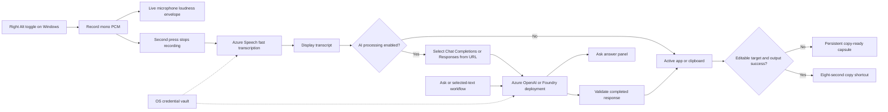

# OpenTypeless — Diagrams

## Azure Voice Input Flow

Other configured STT and LLM providers remain interchangeable. Azure Speech transcribes after stop rather than providing realtime partial text; the LLM can stream preview text through the existing pipeline. Responses target-app insertion waits for successful completion.
